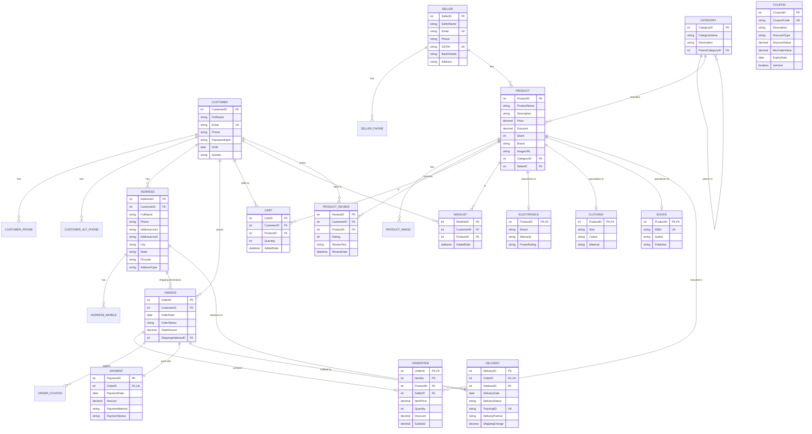

# Experiment 4: Conceptual Database Design & ER Diagram for an Indian E-Commerce Platform

> **DBMS Laboratory**

---

## 📌 Attached Lab Submission
📄 **Original Lab Handwritten PDF**: [DBMS_Exp_1_ER_Diagram.pdf](./DBMS_Exp_1_ER_Diagram.pdf)

---

## 🎯 Aim
To design an **Entity Relationship (ER) Diagram** for an Indian E-Commerce Platform modeling entities: `Customer` / `User`, `Product`, `Order`, `Seller`, `Category`, `Payment`, `Delivery`, `Address`, `Cart`, `Wishlist`, and `Product_Review`. The design incorporates primary keys, foreign keys, composite attributes, multi-valued attributes, weak entities, product specialization / generalization, and participation constraints.

---

## 📖 Theoretical Concepts

An **Entity Relationship (ER) Model** is a high-level conceptual data model used in database design. It visually defines entities, their attributes, and relationships among them:

1. **Entity**: A real-world distinguishable object represented by a rectangle (e.g., `Customer`, `Seller`, `Product`, `Order`).
2. **Attribute**: A characteristic or property of an entity represented by an oval (e.g., `Email`, `Price`, `OrderDate`).
3. **Primary Key**: An attribute or combination of attributes that uniquely identifies an entity instance (underlined in conventional ER diagrams).
4. **Composite Attribute**: An attribute composed of multiple granular sub-attributes:
   - Example: `Address` consists of `DoorNo`, `Street`, `Area`, `City`, `State`, and `Pincode`.
5. **Multi-Valued Attribute**: An attribute that can hold more than one value for a single entity instance, represented by a double oval:
   - Example: Multiple phone numbers (`Customer_Phone`, `Customer_Alt_Phone`, `Seller_Phone`), multiple mobile numbers (`Address_Mobile`), and multiple image URLs (`Product_Image`).
6. **Weak Entity**: An entity whose existence depends on another strong entity and lacks a standalone primary key:
   - Example: `OrderItem` relies on `Order` via `(OrderID, ItemNo)` for identification.
7. **Relationship**: An association among two or more entities represented by a diamond (e.g., `Customer PLACES Order`, `Seller LISTS Product`).
8. **Specialization & Generalization**:
   - `Product` acts as a generalized superclass.
   - Subclasses specialize into distinct categories: `Electronics` (Brand, Warranty, PowerRating), `Clothing` (Size, Colour, Material), and `Books` (ISBN, Author, Publisher).
9. **Participation Constraints**:
   - **Total Participation (Mandatory)**: An entity must participate in the relationship (e.g., every `OrderItem` must belong to an `Order`).
   - **Partial Participation (Optional)**: An entity may or may not participate (e.g., a `Category` may not yet have any subcategories or products).

---

## 📊 Entity Relationship Diagram

---

## 🏷️ Key Entities & Attributes Summary

| Entity | Primary Key | Key Attributes & Constraints | Relationships |
|:---|:---|:---|:---|
| **CUSTOMER** | `CustomerID` | `FullName`, `Email` (UNIQUE), `Phone`, `PasswordHash`, `DOB`, `Gender` | Places Orders, Has Addresses, Adds to Cart/Wishlist |
| **SELLER** | `SellerID` | `SellerName`, `Email` (UNIQUE), `Phone`, `GSTIN` (UNIQUE), `BankDetails`, `Address` | Lists Products |
| **CATEGORY** | `CategoryID` | `CategoryName`, `Description`, `ParentCategoryID` (Self-referential FK) | Classifies Products, Subcategory hierarchy |
| **PRODUCT** | `ProductID` | `ProductName`, `Description`, `Price`, `Stock`, `Brand`, `ImageURL` | Base class for Electronics, Clothing, Books |
| **ADDRESS** | `AddressID` | `DoorNo`, `Street`, `Area`, `City`, `State`, `Pincode`, `AddressType` | Belongs to Customer, Order delivery destination |
| **ORDERS** | `OrderID` | `OrderDate`, `OrderStatus`, `TotalAmount`, `CustomerID` (FK), `ShippingAddressID` (FK) | Has OrderItems, Payment, Delivery, Coupons |
| **ORDERITEM** | `(OrderID, ItemNo)` | `ProductID` (FK), `SellerID` (FK), `Quantity`, `ItemPrice`, `Discount`, `Subtotal` | Composite weak entity linking Orders and Products |
| **PAYMENT** | `PaymentID` | `OrderID` (UNIQUE FK), `PaymentDate`, `Amount`, `PaymentMethod`, `PaymentStatus` | 1:1 relation with Orders |
| **DELIVERY** | `DeliveryID` | `OrderID` (UNIQUE FK), `AddressID` (FK), `TrackingID` (UNIQUE), `DeliveryPartner`, `ShippingCharge` | Fulfils Orders |

---

## 🔗 Next Step
Proceed to **[Experiment 5: Relational Schema Mapping & SQL Implementation](../experiment-5/)** to view the physical relational schema, table creation DDL, sample data DML, and execution tests for referential integrity violations, `ON DELETE SET NULL`, and `ON DELETE CASCADE`.
